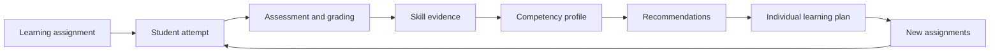
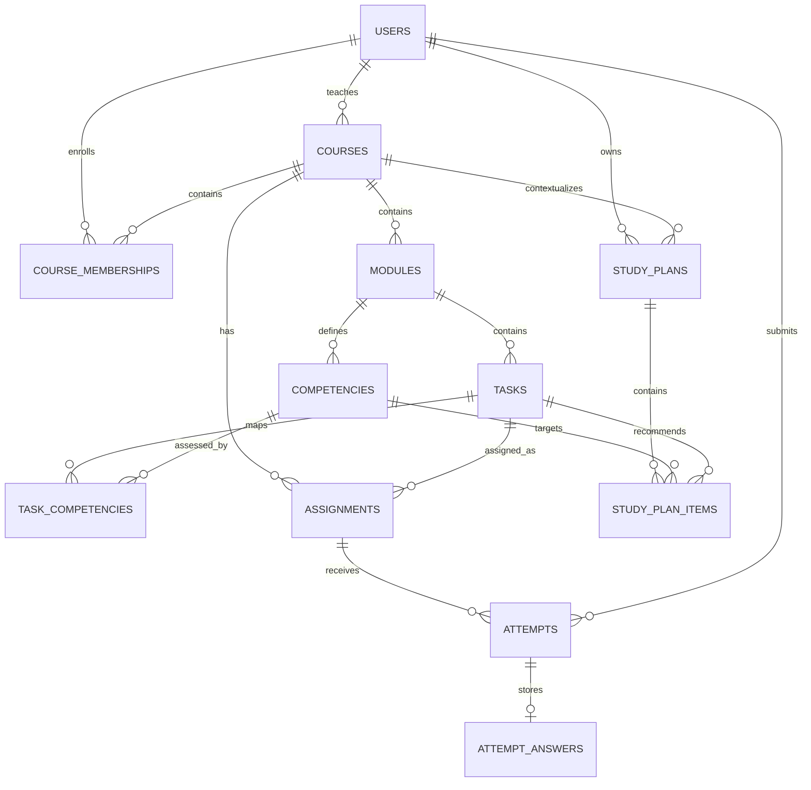
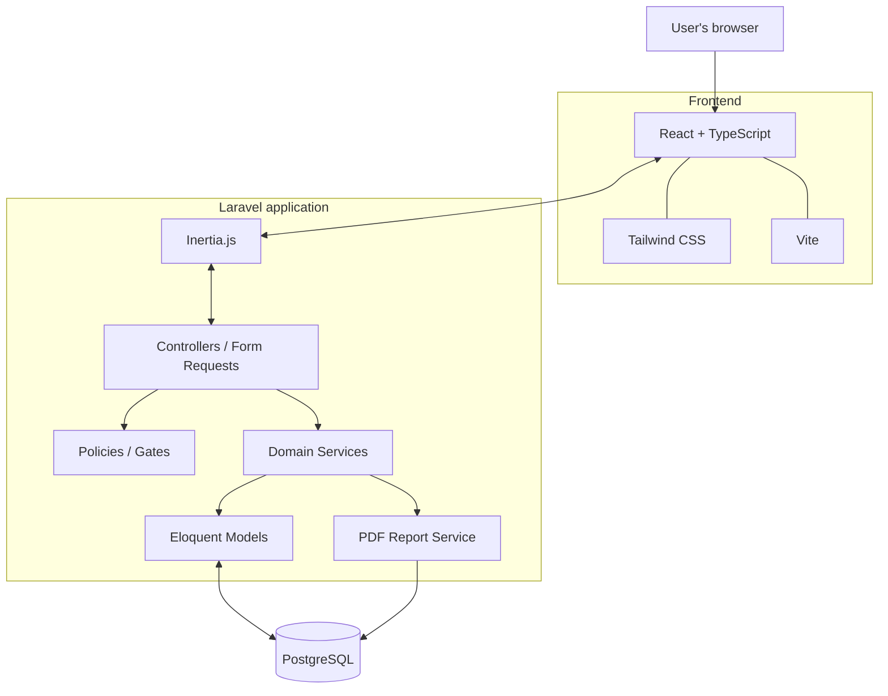

# CodeSkill — Programming Skills Assessment Platform

> **Project working name.** The name may be changed before the public repository is created.
>
> **Qualification work title (LV):**  
> *Tīmekļa platforma programmēšanas prasmju novērtēšanai un individuālo mācību plānu veidošanai*
>
> **Purpose:** A web platform for assessing students' programming skills and creating individual learning plans based on the results of completed assignments.

[](#current-status)
[](https://laravel.com/)
[](https://www.postgresql.org/)
[](https://react.dev/)
[](https://www.typescriptlang.org/)

---

## Table of Contents

- [About the Project](#about-the-project)
- [Problem and Solution](#problem-and-solution)
- [Core Concept](#core-concept)
- [User Roles](#user-roles)
- [Planned Features](#planned-features)
- [Assignment Types](#assignment-types)
- [Competency Assessment Model](#competency-assessment-model)
- [Recommendation System](#recommendation-system)
- [Input and Output Data](#input-and-output-data)
- [Data Model](#data-model)
- [Main Business Processes](#main-business-processes)
- [Architecture](#architecture)
- [Technology Stack](#technology-stack)
- [Planned Project Structure](#planned-project-structure)
- [Local Setup](#local-setup)
- [Security and Privacy](#security-and-privacy)
- [Testing](#testing)
- [Development Roadmap](#development-roadmap)
- [MVP Scope and Future Improvements](#mvp-scope-and-future-improvements)
- [RVT Qualification Work](#rvt-qualification-work)
- [Current Status](#current-status)

---

## About the Project

**CodeSkill** is a concept for an educational web platform that helps teachers and students track the development of specific programming skills.

Unlike a conventional quiz website, the platform connects each assignment to one or more **competencies**. After a student completes an assignment and it is assessed, the system stores the result, updates the student's competency profile, and may recommend additional exercises.

Examples of competencies include:

- variables and data types;
- conditional statements;
- loops;
- arrays and data structures;
- functions and scope;
- algorithmic thinking;
- fundamentals of object-oriented programming;
- SQL and database operations;
- web development fundamentals.

The platform is intended for programming courses in vocational and general education. Fictional courses, assignments, and demo accounts can be used for development, testing, and demonstrations.

## Problem and Solution

### Problem

Student assessment is often reduced to individual grades or a total score. These results do not always show which topics a student understands well and which require additional practice.

Teachers may have to manually connect assignments with course topics and review students' work history. A student may see a final grade without understanding which particular skill should be practised next.

### Solution

CodeSkill brings learning assignments, assessed results, and a competency catalogue together in one system. The platform calculates indicators for individual skills, shows how much assessment data supports each result, and generates explainable recommendations.

**Project value:** moving beyond storing grades towards analysing which skills are supported by completed assignments and which should be developed further.

## Core Concept

The main user and data flow:



The system should not present a calculated indicator as an absolute diagnosis of a student's knowledge. A result depends on the available assignments, their difficulty, their weights, and the number of assessed attempts. Therefore, the interface displays not only the skill level but also the amount of evidence used in the calculation.

## User Roles

The MVP includes three roles, with permissions enforced on the server side.

| Role | Main permissions |
|---|---|
| **Administrator** | Manage users, roles, courses, and system reference data; view general platform information. |
| **Teacher** | Manage assigned courses, modules, competencies, and assignments; create student assignments; assess submissions; view analytics for their students; create and adjust learning plans. |
| **Student** | View available courses and assigned work; submit their own answers; view their results, competency map, feedback, and individual learning plan. |

### Main Access Rules

- A teacher can access only the courses they are assigned to.
- A teacher can view results only for students enrolled in their courses.
- A student can view only their own assignments, attempts, results, and learning plans.
- A student cannot access correct answers or automatic-grading configuration before submitting an assignment.
- Hiding interface elements is not a substitute for server-side authorization: access to data must be checked through Laravel Policies/Gates.

## Planned Features

The functionality below describes the intended MVP. It does not mean that these modules have already been implemented.

### Learning Management

- user registration and account management;
- course creation and teacher assignment;
- student enrollment in courses;
- course division into learning modules;
- competency catalogue management;
- mapping competencies to specific modules.

### Assignment Library

- create, edit, publish, and archive assignments;
- configure assignment type and difficulty level;
- set the maximum score;
- link one assignment to one or more competencies;
- configure the weight of each assignment-to-competency relationship;
- keep automatic-grading answer keys on the server.

### Assignments and Attempts

- assign work to students enrolled in a course;
- set due dates and attempt limits;
- accept student submissions;
- preserve attempt history instead of overwriting previous answers;
- automatically grade supported objective assignment types;
- manually assess open-ended answers as a teacher;
- store scores and feedback.

### Analytics and Individual Learning

- individual competency profiles;
- display skill levels and evidence sufficiency;
- result history and progress over time;
- group analytics by competency;
- automatic selection of assignments for further practice;
- creation of individual learning plans;
- teacher review and editing of recommendations;
- export of individual and group reports to PDF.

## Assignment Types

The MVP is intended to support several assignment formats. The grading method depends on the answer type.

| Type | Example | Grading method |
|---|---|---|
| `single_choice` | Select the correct output of a code snippet. | Automatic server-side grading. |
| `multiple_choice` | Select all correct statements about loops. | Automatic server-side grading. |
| `code_output_prediction` | Predict the output of a short code snippet. | Compare with a predefined answer after normalization. |
| `find_the_error` | Identify a line or type of logical error. | Answer-key comparison for a limited set of options, or manual grading. |
| `short_answer` | Explain the difference between `let` and `const`. | Manual grading against defined criteria. |
| `code_review` / `code_writing` | Write a function or explain how to fix a problem. | Manual teacher assessment using a rubric. |

For open-ended assignments, the teacher can define grading criteria, maximum points, and written feedback.

> **MVP security limitation:** The platform does not execute arbitrary student code directly on the main Laravel server. In the first version, automatic grading is limited to assignment types that can be reliably assessed without executing user-submitted code.

## Competency Assessment Model

One assignment may assess multiple skills. Each relationship between an assignment and a competency has its own weight, `wᵢ`.

### Score Normalization

The result of each graded attempt is converted to a value between `0` and `1`:

\[
r_i = \frac{earned\_points_i}{max\_points_i}
\]

Where:

- `earned_points` is the number of points earned;
- `max_points` is the maximum number of points available;
- `rᵢ` is the normalized assignment result.

### Weighted Competency Score

\[
S = 100 \times \frac{\sum_{i=1}^{n} w_i \cdot r_i}{\sum_{i=1}^{n} w_i}
\]

Where:

- `S` is the competency score, from `0` to `100`;
- `wᵢ` is the assignment's weight for the specific competency;
- `rᵢ` is the normalized assignment result;
- `n` is the number of unique assignments included in the selected period.

### Calculation Rules

1. For each unique assignment, the latest graded attempt by the student within the selected period is used.
2. Unfinished and not-yet-graded attempts are excluded from the calculation.
3. Multiple attempts at the same assignment must not artificially increase that assignment's weight.
4. All attempts are retained and can be reviewed separately to analyse progress.
5. If a competency has fewer than **three unique graded assignments**, the system displays **"Insufficient data"**. A provisional score may still be shown together with its evidence coverage, for example `78/100 · 2 of 3 assignments`.

### Initial Proficiency Levels

The thresholds below are configurable project values, not an official RVT grading scale.

| Score | Interpretation | Possible action |
|---:|---|---|
| 0–49 | Foundational knowledge needs reinforcement | Basic exercises and topic review. |
| 50–69 | Skill is developing | Additional basic and intermediate practice. |
| 70–84 | Competent level | Reinforce the skill and apply it in new contexts. |
| 85–100 | Strong performance based on available evidence | An advanced assignment or the next topic. |

The score is interpreted together with evidence sufficiency. A high result on a single assignment should not automatically mean that a skill has been fully mastered.

## Recommendation System

The MVP recommendation system is intended to be **deterministic and explainable**. It does not require an AI/ML model.

For each competency, the system checks:

- the calculated score;
- the number of unique graded assignments;
- whether there is enough assessment evidence;
- published assignments linked to the competency;
- the student's assignment completion history.

### Priority Calculation

The following indicator can be used to sort topics in a learning plan:

\[
P = 0.7 \times (1 - S/100) + 0.3 \times (1 - \min(N/3, 1))
\]

Where:

- `P` is the competency priority;
- `S` is the competency score, from `0` to `100`;
- `N` is the number of unique graded assignments for the competency.

The higher the value of `P`, the higher the topic's priority when generating a learning plan. The formula considers both a low score and a lack of supporting assignments. It is a transparent project rule, not a scientifically validated diagnostic model.

### Learning Plan Contents

Each plan item may contain:

- the competency recommended for further development;
- the reason for the recommendation;
- a recommended assignment;
- difficulty level and suggested order;
- current status: `planned`, `in_progress`, `completed`, or `skipped`.

The teacher can approve or modify the plan by removing an unsuitable assignment, adding another one, or changing the order. The student can view the resulting plan and track the status of each item.

## Input and Output Data

### Input Data (`Ieejas informācija`)

- user details and roles;
- course, module, and enrollment information;
- competency names and descriptions;
- assignment instructions, types, difficulty levels, and grading criteria;
- student answers and attempt information;
- teacher scores and comments;
- filter parameters: course, student, competency, status, and date range.

All submitted data must be validated on the server for format, required fields, score ranges, and access permissions.

### Output Data (`Izejas informācija`)

| Output | Contents | Users |
|---|---|---|
| Individual skill map | Competency scores, proficiency levels, number of graded assignments, and evidence sufficiency. | Student, teacher |
| Group analytics | Group averages, proficiency-level distribution, and number of graded submissions. | Teacher |
| Filtered results | Submissions and results by course, module, student, competency, status, and period. | Teacher |
| Individual PDF report | Skill profile, progress, strengths, development areas, and learning plan. | Student, teacher |
| Group PDF report | Group summary and competencies that may need further attention. | Teacher |
| Individual learning plan | Prioritized topics, assignments, explanations, and completion statuses. | Student, teacher |

## Data Model

The MVP proposes 12 main PostgreSQL entities.

| Table | Purpose |
|---|---|
| `users` | User accounts, roles, and account statuses. |
| `courses` | Courses and their assigned teacher. |
| `course_memberships` | Relationship between students and courses (N:M). |
| `modules` | Learning modules within a course. |
| `competencies` | Catalogue of skills and competencies. |
| `tasks` | Library of learning assignments. |
| `task_competencies` | Relationship between assignments and competencies, including the relationship weight (N:M). |
| `assignments` | Assignment issued to a specific course. |
| `attempts` | History of students' attempts to complete assignments. |
| `attempt_answers` | Submitted answer, score, feedback, and grading information. |
| `study_plans` | Individual student learning plans. |
| `study_plan_items` | Competencies and assignments included in a learning plan. |

### Main Relationships



### Database Design Principles

- Use PostgreSQL foreign keys and integrity constraints.
- Add unique constraints for user email, the `course_id + user_id` pair, the `task_id + competency_id` pair, and the attempt number within an assignment and student context.
- Ensure that scores cannot be lower than zero or higher than the assignment's maximum score.
- Use transactions when submitting and grading attempts and when updating related records.
- Store core entities in normalized relational tables.
- Use `JSONB` for structured answers and configuration of different assignment types, not as a replacement for primary relational data.

## Main Business Processes

The project contains nine key data-processing processes that can be represented in DPD diagrams.

| ID | Process | Result |
|---|---|---|
| P1 | User and course management | Users, roles, courses, and course membership records. |
| P2 | Assignment creation and competency mapping | A published assignment linked to at least one competency. |
| P3 | Assignment distribution to a course | An active assignment with a due date and attempt limit. |
| P4 | Student answer submission | A stored attempt with its status and submitted answer. |
| P5 | Automatic or manual grading | Score, feedback, and grading status. |
| P6 | Competency profile calculation | Skill indicators together with the amount of supporting evidence. |
| P7 | Recommendation selection | Prioritized topics and suitable assignments. |
| P8 | Learning plan creation and adjustment | A learning plan with ordered items and statuses. |
| P9 | Analytics and report generation | Filtered data, charts, and PDF documents. |

End-to-end example: a teacher assigns an exercise about loops → a student submits an answer → the system grades it automatically or sends it for manual assessment → the result is stored → the competency profile is recalculated → additional practice about loops is added to the learning plan when appropriate.

## Architecture

The proposed MVP architecture is **Laravel + Inertia.js + React**. This approach allows Laravel to handle routing, authorization, and business logic while using React for the interface, without requiring a separate API client for every page.



### Component Responsibilities

| Component | Responsibility |
|---|---|
| Laravel | Authorization, roles, validation, routes, business rules, and data access. |
| Inertia.js | Connects server-side routes and React pages. |
| React + TypeScript | Forms, tables, interactive pages, and result visualizations. |
| Tailwind CSS | Styling and responsive layouts. |
| PostgreSQL | Stores users, courses, assignments, answers, results, and learning plans. |
| Domain Services | Encapsulate competency scoring and recommendation logic. |
| PDF service | Generates individual and group reports. |

### Proposed Backend Services

- `CompetencyScoringService` — retrieves the latest graded attempts and calculates competency scores.
- `RecommendationService` — calculates priorities and selects suitable assignments.
- `StudyPlanService` — creates and updates individual learning plans.
- `AttemptGradingService` — handles automatic and manual grading.
- `ReportService` — prepares data for PDF reports.

## Technology Stack

| Area | Technology |
|---|---|
| Backend | PHP, Laravel |
| Database | PostgreSQL |
| Frontend | React, TypeScript |
| Server/client integration | Inertia.js |
| Build tooling | Vite |
| Styling | Tailwind CSS |
| ORM | Laravel Eloquent |
| Authorization | Laravel Policies / Gates |
| Validation | Laravel Form Requests + TypeScript types |
| Testing | PHPUnit or Pest; frontend tests as needed |
| Reports | Laravel-compatible PDF package |

Exact dependency versions should be selected to match the chosen Laravel version and recorded in `composer.lock` and `package-lock.json`.

## Planned Project Structure

The following is a proposed code organization. The actual structure may change during implementation.

```text
codeskill/
├── app/
│   ├── Http/
│   │   ├── Controllers/
│   │   └── Requests/
│   ├── Models/
│   ├── Policies/
│   └── Services/
│       ├── AttemptGradingService.php
│       ├── CompetencyScoringService.php
│       ├── RecommendationService.php
│       ├── StudyPlanService.php
│       └── ReportService.php
├── database/
│   ├── factories/
│   ├── migrations/
│   └── seeders/
├── resources/
│   └── js/
│       ├── Components/
│       ├── Layouts/
│       ├── Pages/
│       ├── Types/
│       └── Utils/
├── routes/
│   └── web.php
├── tests/
│   ├── Feature/
│   └── Unit/
├── public/
├── .env.example
├── composer.json
├── package.json
└── README.md
```

## Local Setup

> **Note:** The repository is currently in the planning stage. The commands below describe the expected setup for a Laravel/Inertia application after its project skeleton has been created. They do not mean that the application is already complete or that all migrations and seeders currently exist.

### Requirements

- A PHP version supported by the selected Laravel version;
- Composer;
- Node.js and npm;
- PostgreSQL;
- Git.

### Installation

```bash
# 1. Clone the repository
git clone <REPOSITORY_URL>
cd codeskill

# 2. Install PHP dependencies
composer install

# 3. Create a local environment file
cp .env.example .env

# 4. Generate the application key
php artisan key:generate

# 5. Install frontend dependencies
npm install
```

### Database Configuration

Create a PostgreSQL database and configure the connection in `.env`:

```dotenv
APP_NAME=CodeSkill
APP_ENV=local
APP_KEY=
APP_DEBUG=true
APP_URL=http://localhost:8000

DB_CONNECTION=pgsql
DB_HOST=127.0.0.1
DB_PORT=5432
DB_DATABASE=codeskill
DB_USERNAME=postgres
DB_PASSWORD=your_local_password
```

Do not commit real passwords, tokens, or other secrets to Git. The `.env` file must remain in `.gitignore`; only `.env.example` without secret values should be stored in the repository.

After the migrations and seeders have been created:

```bash
php artisan migrate --seed
```

### Run the Application

In the first terminal:

```bash
php artisan serve
```

In a second terminal:

```bash
npm run dev
```

The default local Laravel address is `http://127.0.0.1:8000`.

Build the frontend for production:

```bash
npm run build
```

The available npm scripts will depend on the actual `package.json` configuration.

## Security and Privacy

Because the platform handles educational results, access control is part of the business logic, not just the user interface.

Planned measures:

- store passwords only as secure hashes;
- enforce roles and data ownership through server-side Policies/Gates;
- validate all incoming data on the server;
- check due dates and attempt limits before accepting a new attempt;
- prevent access to correct-answer keys before an assignment is submitted;
- save answers and grading results transactionally;
- restrict access to individual and group PDF reports;
- use synthetic data for demonstrations;
- avoid public disclosure of students' personal results.

**Executing arbitrary user-submitted code is outside the MVP scope.** A future code runner would require a separate isolated execution environment with resource and network restrictions. Untrusted student code must not be executed inside the main Laravel application.

## Testing

The proposed testing approach includes the following levels:

| Type | What is tested |
|---|---|
| Unit tests | Competency scoring formulas, score normalization, recommendation priorities, and score boundaries. |
| Feature tests | Authorization, roles, course access, assignment creation, attempt submission, and grading. |
| Integration tests | The complete flow from assignment distribution to competency updates and recommendation generation. |
| UI / manual tests | Forms, filters, empty states, analytics display, responsive layout, and PDF output. |

Examples of required checks:

- a student cannot access another student's attempt or learning plan;
- a teacher cannot grade submissions belonging to a course they do not teach;
- an attempt cannot be submitted after the due date or after the attempt limit has been reached;
- scores cannot be below zero or above the maximum score;
- ungraded attempts are excluded from competency calculations;
- a repeated attempt is not counted at the same time as an earlier attempt for the same assignment;
- a competency with fewer than three unique graded assignments is marked as "Insufficient data";
- a PDF report contains the correct student, course, and selected period.

After backend tests have been added, they can be run with:

```bash
php artisan test
```

## Development Roadmap

The recommended development order is to implement one complete end-to-end workflow first, then add advanced analytics.

| Phase | Outcome |
|---|---|
| 1. Analysis and design | Approved requirements, roles, ERD, DPD, and mockups of key screens. |
| 2. Application foundation | Laravel, PostgreSQL, Inertia, React, TypeScript, Tailwind, authentication, and roles. |
| 3. Learning structure | Courses, members, modules, and competencies. |
| 4. Assignments and distribution | Assignment library, competency mapping, due dates, and attempt limits. |
| 5. Attempts and grading | Answer submission, automatic grading for objective assignments, and manual grading for open-ended work. |
| 6. Analytics | Competency scoring, progress history, and individual and group statistics. |
| 7. Recommendations | Prioritized topics, assignment selection, and an editable individual learning plan. |
| 8. Reports and quality assurance | PDF reports, tests, error handling, documentation, and demo data. |

## MVP Scope and Future Improvements

### Included in the MVP

- three roles: administrator, teacher, and student;
- courses, members, modules, and competencies;
- assignment library and competency mapping;
- assignment distribution, attempts, automatic and manual grading;
- competency scoring;
- individual and group analytics;
- explainable recommendations and individual learning plans;
- PDF reports;
- tests for key business processes.

### Outside the MVP Scope

- execution of arbitrary PHP, JavaScript, Python, or other code on the main server;
- a complex AI/ML model for predicting student grades or behaviour;
- integrations with external LMS platforms, electronic gradebooks, and GitHub Classroom;
- video courses, video conferencing, and chat;
- separate iOS/Android mobile applications.

### Possible Future Improvements

- a dedicated secure code runner in isolated infrastructure;
- assignment and result imports from CSV;
- additional grading types and more flexible rubrics;
- integrations with external educational platforms;
- interface localization;
- advanced analytics for recurring mistakes and progress by topic.

## RVT Qualification Work

The project is being developed as a potential qualification work for the **Programmēšanas tehniķis** study programme at Rīgas Valsts tehnikums (RVT).

**Proposed qualification work title in Latvian:**

> Tīmekļa platforma programmēšanas prasmju novērtēšanai un individuālo mācību plānu veidošanai

**Project objective:** to develop a web platform that assesses students' programming skills based on the results of learning assignments and generates individual recommendations for further learning.

The project can demonstrate:

- analysis of a subject area and formalization of requirements;
- relational database design in PostgreSQL;
- web application development with Laravel and React;
- implementation of role-based access control and server-side authorization;
- input data processing and validation;
- algorithms for competency assessment and recommendation ranking;
- generation of analytical queries and PDF reports;
- testing of business processes and documentation of the solution.

The written qualification work should separately include an ER diagram, DPD diagrams, algorithm descriptions, test cases, and a user guide. The final topic title and documentation format must be agreed with the RVT supervisor.

## Current Status

<details>
<summary>Planned module status</summary>

| Module | Status |
|---|---|
| Project concept and problem statement | Documented |
| Preliminary ER model | Designed |
| User role model | Designed |
| Competency scoring algorithm | Designed |
| Recommendation algorithm | Designed |
| Backend | Not implemented / depends on the current repository state |
| Frontend | Not implemented / depends on the current repository state |
| PostgreSQL migrations and seeders | Not implemented / depends on the current repository state |
| Tests | Not implemented / depends on the current repository state |
| PDF reports | Planned |

</details>

This README describes the target concept and planned functionality. Update the status table as implementation progresses so that the repository documentation accurately reflects the working application.

---

**Note:** CodeSkill is a working name for this educational project. The thresholds, assessment model, and recommendation rules are project assumptions and should be tested using sample data and discussed with the qualification work supervisor.
